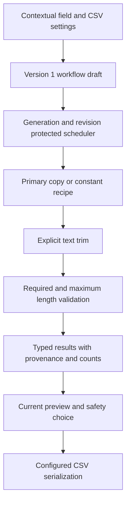
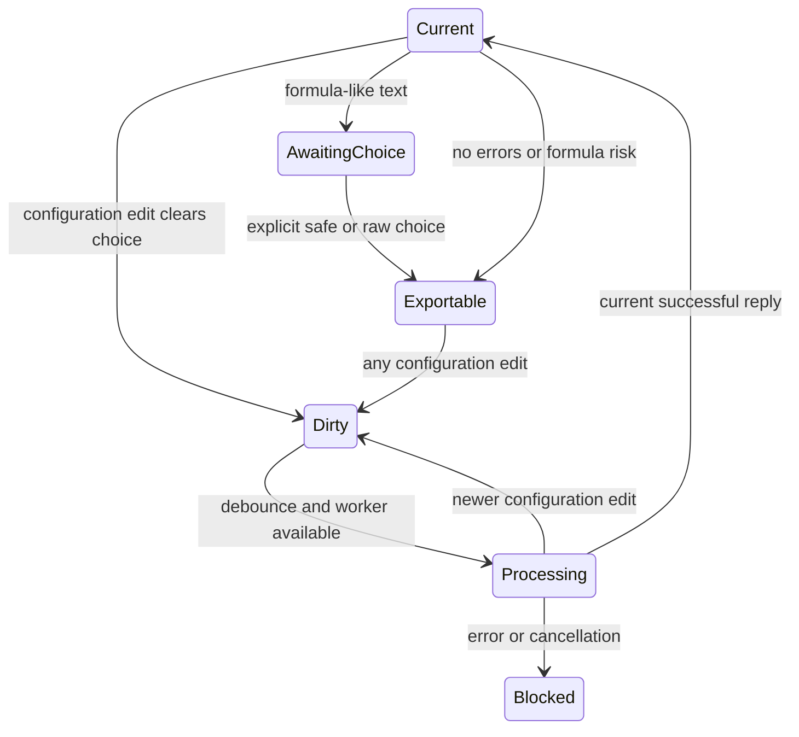

# U3 Fixed Fields, Explicit Trim and CSV Settings - Plan

## Goal Capsule

- Objective: Operators can prepare import CSVs with fixed output values, deliberate whitespace trimming and the required CSV layout, then inspect and download the current result.
- Means: Extend the existing version 1 recipe engine and paired-card workspace (KTD1–KTD4).
- Authority: The user authorizes U3 planning, implementation, testing and a draft PR against main; the PRD and approved master plan govern semantics.
- Stop conditions: No merge, deployment, U4 persistence or substantial redesign of the approved U2 interface. The user personally tests and approves UX before the PR leaves draft.
- Execution: The implementation agent finishes production changes, verification, CE simplification/review, finding validation, evidence and draft PR updates.

---

## Product Contract

### Summary

Deliver master-plan U3 only: fixed text, number and intentional-blank fields; explicit text trimming; and CSV delimiter, BOM and header controls.
Use existing contextual field settings and place CSV controls beside preview/download.

### Problem Frame

A source export often lacks required customer codes or service values, includes meaningful boundary spaces, or needs a different CSV layout for an import.
U2 currently supports copying text with only default CSV settings.

### Requirements

**Values and validation**

- R1. Fixed values generate every candidate source row without a source association, preserving text literally and numbers as exact decimal strings; optional blanks succeed and required blanks fail (FR-40, AC-07).
- R2. Text trimming is off by default and removes only explicitly selected boundary whitespace before required and maximum-length validation, without changing source values (FR-12, KTD-04).
- R3. Copies and constants retain typed results, row provenance, complete counts, validation and formula-safety checks, including formula-like constant text (KTD-03/04/06).

**CSV and current results**

- R4. Configure comma, semicolon or tab delimiter, UTF-8 BOM on/off and header on/off in the existing workflow; preserve comma/no BOM/header/CRLF defaults (FR-45, AC-16).
- R5. All configuration changes automatically schedule the current preview and invalidate prior export eligibility and formula handling choices; no obsolete worker result may become downloadable.
- R6. CSV bytes preserve output order, UTF-8, quotes, embedded delimiters/newlines and CRLF across all twelve delimiter/BOM/header combinations.

**Experience and verification**

- R7. Preserve U2 bidirectional matching, reusable sources, matched-slot reorder, unmatched grouping and keyboard alternatives while completed constants appear configured without a fake source connection.
- R8. Prove U3 using unit and production-build browser tests, synthetic examples, desktop/laptop screenshots, privacy sentinels and the existing full-dataset/performance checks; record cross-browser limits honestly.

### Scope Boundaries

U3 does not introduce dependencies, alternate transformation models, automatic cleanup, output-field dependencies, configurable encodings, extra export formats or partial exports.
No source corrections, split/combine/arithmetic/date operations, Excel integration, suggestions or saved-workflow storage are delivered here.
Existing source template handling and U1/U2 acceptance remain in place.

### Sources

- `docs/PRD.md`: FR-12, FR-38, FR-40, FR-45, AC-07/16/17/20/21.
- `docs/plans/2026-10-11-1607-feat-operations-data-cleaner-plan.md`: U3 and KTD-03/04/06; other units remain deferred.
- `docs/design/u2/paired-cards/SPECIFICATION.md`: approved interaction and completed-slot reorder rules.
- `docs/reviews/u2-paired-cards/review-followup.md`: active selection, announcements, downward reorder and private output-header regression coverage.

---

## Planning Contract

### Key Technical Decisions

- KTD1. Use existing strict version 1 variants in `src/engine/workflow.ts`, not a second model. The schema already declares constants, trim and CSV settings, while runtime validation deliberately blocks them; expand only U3 support and keep unsupported variants failing clearly (R1–R4).
- KTD2. Keep numeric constants as validated lexical decimal strings, including `12.50`, leading zeroes and explicit plus signs; use no JavaScript number conversion or arithmetic dependency. Constant type and field type must agree, trim/max-length remain text-only, and malformed/incompatible settings block exports. Optional intentional blanks may use delivered text or number types. Preserve current required semantics: whitespace-only text is blank whether trim is enabled or not (R1–R3).
- KTD3. Model completed outputs as copy mappings or valid constant recipes. Retain existing pair rows for copies; show fixed output rows in the same completed group with a noninteractive source-side “Fixed value · no source needed” summary and no connection arrow. Include these rows in completed-slot drag/keyboard reorder without moving unmatched slots. Keep fixed type/value/intentional blank and trim inside the contextual dialog (R7).
- KTD4. Route fields and output settings through one workflow mutation path in `src/ui/Workspace.tsx`. Preserve generation tracking, debounce, dirty export lock, controller revision checks and cancellation. Clear formula choice on every relevant edit and keep settings editable through the existing pending-run scheduling behavior (R5).
- KTD5. Extend result provenance to identify constant origin and applied trim without inventing a source column. Preserve actual source row identity for every output and the existing copy provenance information (R3).

### High-Level Technical Design

Data flows through the existing modules; only supported recipe execution, modifiers and CSV settings widen.
Header-off downloads omit header formula risk because labels are not emitted; the UI explains that column labels remain visible only for preview.

The export eligibility states retain the existing transitions.

CSV format combinations are the cartesian product below, with independent exact-byte expectations.

| Delimiter | BOM off/header on | BOM on/header on | BOM off/header off | BOM on/header off |
| --- | --- | --- | --- | --- |
| Comma | Default | BOM prefix | Data only | BOM plus data |
| Semicolon | Header and data | BOM prefix | Data only | BOM plus data |
| Tab | Header and data | BOM prefix | Data only | BOM plus data |

### Sequencing and Risks

Implement U1, then U2, then U3 below; these IDs are local work packets inside master-plan U3.
Keep the current U2 sample action stable and add a separately named synthetic U3 example.
Do not expand numeric support to copied numeric conversion, scale or rounding rules from future U7.

The U2 evidence records browser installation and performance-budget limitations; implementation must rerun the required checks and separate fidelity success from timing failures.
Neither missing browser executables nor CI pending status proves cross-browser behavior.

---

## Implementation Units

### U1. Typed constants, explicit trim and configured CSV bytes

**Goal:** Deliver deterministic U3 data semantics in the existing engine and adapter.
**Requirements:** R1–R6; KTD1, KTD2, KTD5.
**Dependencies:** Merged U2 on latest main.
**Files:** `src/engine/workflow.ts`, `src/engine/recipes.ts`, `src/engine/validation.ts`, `src/engine/values.ts`, `src/formats/csv.ts`, `tests/unit/constants.test.ts`, `tests/unit/trim.test.ts`, `tests/unit/csv-options.test.ts`, `tests/unit/workflow.test.ts`, `tests/unit/safety.test.ts`.
**Approach:** Expand semantic validation and evaluate typed constants in the existing field loop, apply explicit trim, then existing row rules and text-only formula detection. Serialize configured header/delimiter/BOM with the current CSV quoting implementation. Preserve unsupported-format/recipe failures for future units.
**Patterns to follow:** `referencedHeaders` already omits constants; `displayValue` already emits numeric decimal strings; `serializeCsv` already enforces row and formula safety.
**Test scenarios:**
1. `0012` and boundary spaces remain text; `12.50`, a large decimal and a negative decimal retain exact number representations without formula warnings.
2. A constant-only workflow has no source-column references and emits one result per nonblank source row, including optional blank and required-blank failure.
3. Provenance distinguishes constants from copies, preserves source record/line identity, and records explicit trim without mutating source cells.
4. Explicit trim removes boundary spaces and preserves internal spaces; default keeps all spaces; required and max-length validation inspect the resulting text.
5. Formula-like constants require safe/raw selection and produce the expected raw/escaped bytes; malformed literals and type/modifier conflicts fail workflow validation.
6. All twelve CSV combinations match independent byte goldens containing commas, semicolons, tabs, quotes, LF/CRLF within fields and UTF-8 text, including reordered output fields.
**Verification:** Unit tests establish values, strict configuration failures, provenance, validation and exact bytes with U2 regressions passing.

### U2. Contextual fixed values and CSV controls

**Goal:** Make U3 configurable while retaining the approved matching interface.
**Requirements:** R5, R7; KTD3, KTD4.
**Dependencies:** U1.
**Files:** `src/ui/MappingRows.tsx`, `src/ui/Workspace.tsx`, `src/ui/styles.css`, `tests/e2e/constants.spec.ts`, `tests/e2e/row-mapping.spec.ts`, `tests/e2e/review-regressions.spec.ts`, `tests/unit/session.test.ts`.
**Approach:** Add copy/fixed choice and typed fixed value/intentional blank controls to the existing output settings dialog. Add an explicitly labelled trim option for text. Generalize configured-row grouping/reorder just enough for KTD3. Place CSV controls with preview/download and use KTD4 for all changes.
**Patterns to follow:** Preserve existing card events, focus restoration, announcements, settings dialog and generation-protected scheduling.
**Test scenarios:**
1. Configure fixed text/number/blank fields with no mapping; completed cards show their values/states and cease appearing unmatched.
2. Drag and keyboard reorder constants among copied fields with an unmatched slot retained; preview and downloaded data keep value/type/order.
3. Switch fixed to copy and copy to fixed, replace a fixed output by explicit source matching, reuse sources, unlink, and preserve bidirectional/keyboard U2 interactions.
4. Enable trim contextually and verify preview, validation, download and read-only original-source display agree.
5. Edit constants, trim and each CSV setting during debounce and pending processing; stale results stay blocked and prior formula acknowledgement is cleared.
6. Keyboard focus, selected state and live announcements remain usable; fixed summaries are not presented as source cards or connections.
**Verification:** Production-build browser tests prove settings, matching, ordering, safety decisions and stale-download behavior using actual downloaded bytes.

### U3. Synthetic demonstration, full verification and review evidence

**Goal:** Prepare a reviewable U3 delivery with reproducible evidence and accurate capability claims.
**Requirements:** R8 and all regression constraints.
**Dependencies:** U1, U2.
**Files:** `examples/u3-source.csv`, `examples/u3-workflow.json`, `src/ui/Workspace.tsx`, `tests/unit/sample.test.ts`, `tests/e2e/constants.spec.ts`, `tests/e2e/privacy.spec.ts`, `tests/e2e/performance.spec.ts`, `tests/README.md`, `README.md`, `.github/workflows/u2.yml`, `docs/reviews/u3/`.
**Approach:** Add a distinct U3 example, document released controls/exclusions, extend privacy interception with constant sentinels and keep baseline fidelity/performance coverage. Archive screenshots and actual command/browser results. Update CI labeling if useful without changing the production-build browser matrix.
**Test scenarios:**
1. The U3 example demonstrates leading-zero fixed text, exact number, optional blank, trim and nondefault CSV settings; existing U2 sample behavior remains unchanged.
2. Context-wide interception observes no source or configuration content transmissions, including a distinctive constant sentinel, output-header sentinel and diagnostics.
3. Existing 10,000-row and under-500-row performance/fidelity checks retain full row counts, ordering and provenance; timing limits are reported separately if unmet.
4. Desktop 1440px and laptop 1024px screenshots show copied and fixed completed outputs, contextual controls and CSV settings; existing 25-source/30-output scalability checks remain applicable.
5. Chromium, Firefox and WebKit production tests run when installed; attempts and available GitHub CI results distinguish failures, blocked environments and passes.
**Verification:** Required checks, prescribed CE simplification/code review, independently validated fixes and affected reruns are archived and reflected in the draft PR.

---

## Verification Contract

| Check | Command | Evidence |
| --- | --- | --- |
| Types | `npm run typecheck` | Pass |
| Static quality | `npm run lint` | Pass |
| Domain/bytes | `npm run test:unit` | Existing and U3 cases pass |
| Production output | `npm run build` | Build succeeds |
| Browser behavior | `npm run test:e2e` | Production server, all configured projects attempted |
| Privacy | `npm run test:privacy` | No data/configuration egress |
| Performance/fidelity | `npm run test:performance` | Full dataset correctness and measured budgets |

Inspect actual downloads rather than relying on snapshots or CSV reader/writer round trips alone.
Use GitHub CI for additional browser evidence where the local runtime cannot install browsers; retain pending or failed results honestly.
No release validation script exists in this repository and deployment is not authorized.

---

## Definition of Done

- U1/U2/U3 local work packets deliver R1–R8 with no reopened U1/U2 product milestones or future-unit behavior.
- Tests, examples, docs, desktop/laptop screenshots and reproducible browser/privacy/fidelity results are available under `docs/reviews/u3/`.
- Mandatory CE simplification and code review complete, findings are independently validated, confirmed issues fixed and affected tests rerun, with unavailable cross-model capability clearly identified.
- Abandoned experiments and dead code are removed; no dependency or source/configuration transmission is added.
- A draft U3 PR targets main and describes delivered scope, design choices, exact commands/results, browser limits, CE evidence and remaining risks.
- No merge or deployment occurs; hands-on UX approval remains with the user.
