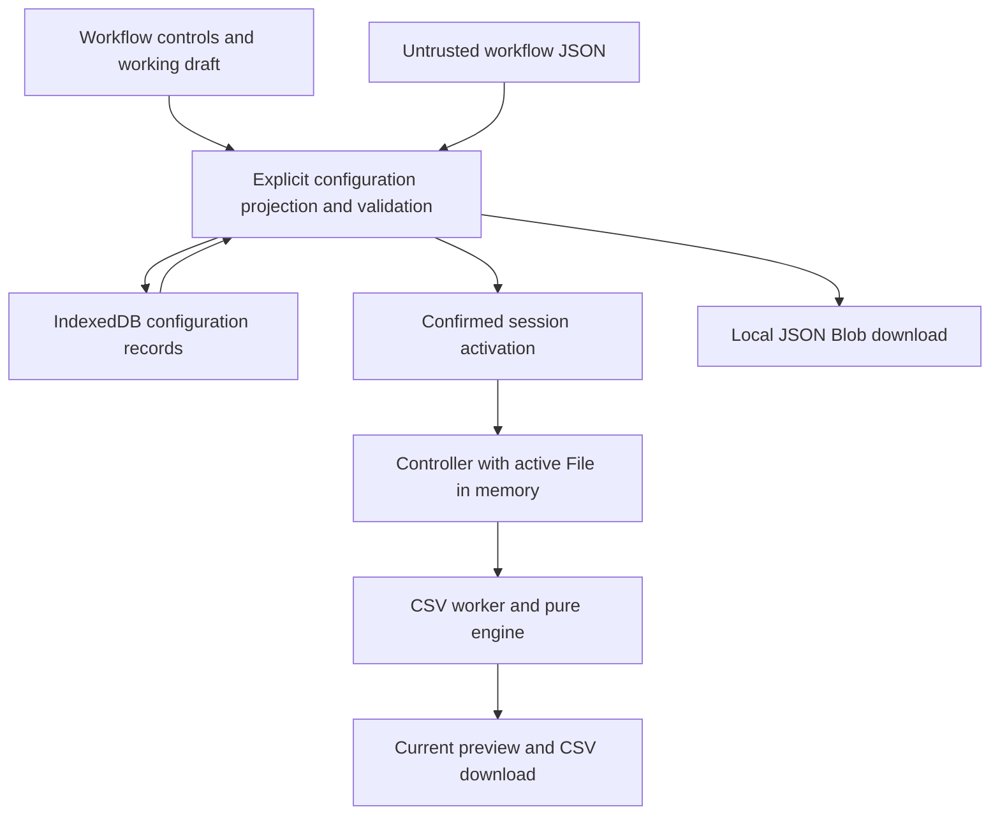
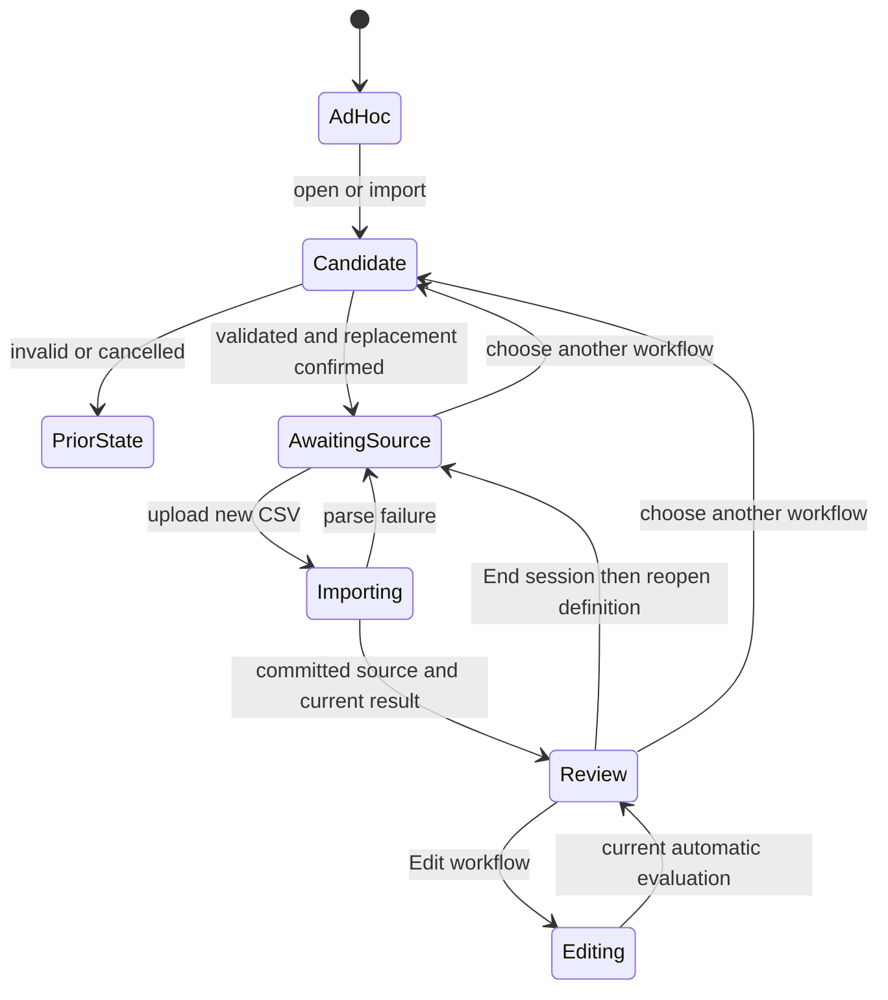
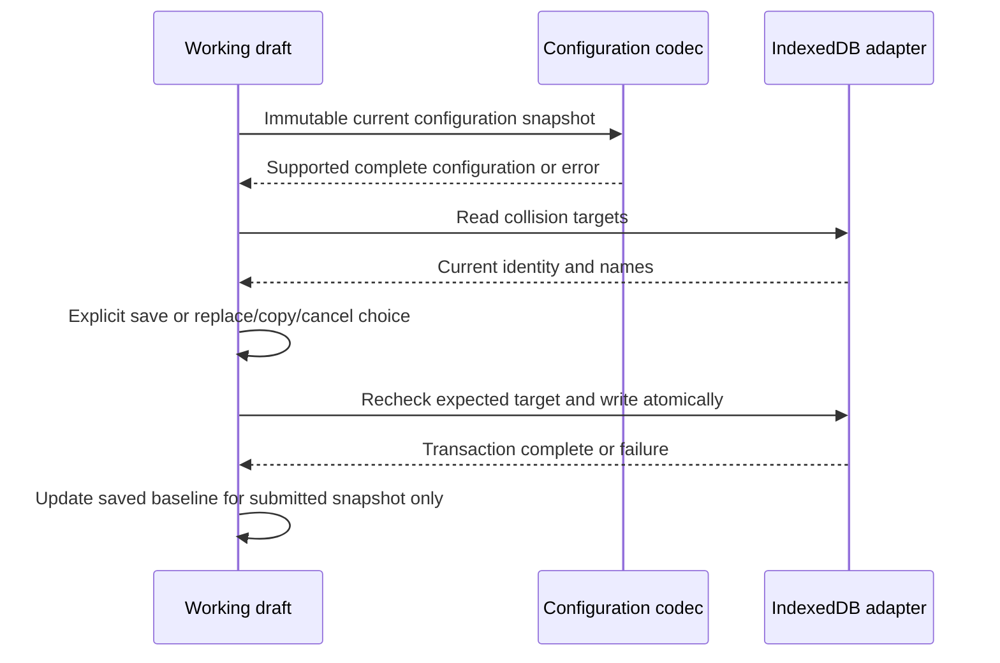

# U4 Save, Repeat and Portable Workflow Backup - Plan

## Goal Capsule

- Objective: Operators can reuse an approved conversion with new source files and recover or transfer its configuration without remapping.
- Means: Extend the existing version 1 workflow with native IndexedDB, portable JSON and a repeat-run entry path (KTD1–KTD6).
- Authority: This request authorizes planning and saving this document only. `AGENTS.md`, `docs/PRD.md` and master-plan U4 govern the eventual implementation; the approved U2/U3 interface remains binding.
- Execution boundary: A separately authorized implementer completes the local work packets, verification and focused branch/PR delivery. Do not implement, commit, push, merge or publish from this planning request.
- Stop conditions: Surface any conflict with the product contract rather than changing fidelity, privacy, source matching or the approved interface. U5 and later master units remain outside this plan.

---

## Product Contract

### Summary

Deliver master-plan U4: explicitly save a named configuration in this browser, reopen it with new data, and download/import a portable backup that works in a separate browser or local instance.
The existing copy, typed constant, intentional blank, explicit trim, validation, output order and CSV settings must retain their meaning.
Product Contract unchanged from the U4 subset of the PRD and master plan.

### Problem Frame

U3 prepares a conversion accurately, but its configuration disappears on reload.
Daily operators need a short repeat journey, and browser-specific storage needs a portable recovery path.

### Requirements

**Save and reuse**

- R1. Ad hoc processing stays available without an account or save; only explicit Save persists a named, complete, supported configuration (FR-29–30).
- R2. Saved configuration retains normalized referenced headers, stable field identities, ordered recipes, all delivered validation/modifier settings and source/output format choices, including the chosen source delimiter policy (FR-04,10,30,39,45).
- R3. Open a saved/imported workflow, upload compatible new data, automatically review and export without remapping or opening the editor; editing remains optional and unsaved edits never silently update the saved definition (AC-18; PRD §6.2).
- R4. Reordered/extra source columns and prescribed header normalization remain compatible. Missing, blank, duplicate normalized or merely similar renamed headers block processing without substitution (FR-37,39; AC-12).

**Backup and safe import**

- R5. Download/import versioned JSON with equivalent behavior across separate browser contexts and hosted/local origins; a valid configuration alone defines destination columns (FR-31,46; AC-19).
- R6. Validate before activation or storage. Reject malformed, over-budget, unsupported-version and unsupported-capability configurations safely; never execute workflow strings or silently reinterpret rules (FR-33,46).
- R7. Name or identity collisions require explicit replace, save-copy or cancel. First successful local save prominently offers a nonblocking backup prompt; Download workflow remains accessible independently of storage availability (FR-32; master KTD-08).
- R8. Explain that local workflows are browser/origin-specific and clearable, and that field names and configured constants can reveal business information when shared (NFR-04; FR-31–32).

**Privacy and resilience**

- R9. Persist/download configuration only: no source filenames, uploaded rows, preview samples, source-row IDs, issues, corrections, session state or CSV safety acknowledgements. All source/configuration processing remains local with no data-bearing network requests (NFR-01–06; AC-20).
- R10. Storage denial, quota, blocked open, aborted write and corrupt records preserve the active draft and ad hoc conversion; portable download stays usable. Failed/cancelled imports leave the prior workflow, source and saved entries intact (master KTD-08).
- R11. Preserve the approved paired-card matching, contextual U3 settings, automatic preview, keyboard controls, full-dataset counts and current-revision export safeguards. Qualify repeat conversion with synthetic 10,000-row data (AC-21; NFR-07–14).

### Scope Boundaries

This plan covers CSV copies, text/number/blank constants, explicit text trim, required/max-length rules and all delivered CSV options.
Version 1 already declares additional recipe/format variants; declaring them does not mean this build supports them.
No migrations are needed for a nonexistent older supported format.

No backend, cloud sync, accounts, telemetry, runtime CDN, arbitrary scripts, plugin registry, persistent source history or automatic remapping.
No database framework, new UI framework, router, storage-permission prompt or background autosave is needed.
Library deletion, bulk organization, search, backup scheduling and cross-tab live synchronization are considered but not built: a small selectable list and explicit save cover U4; change this only with demonstrated operator need.
Conflict detection at write time is included because unnoticed overwrites would lose stored configuration; live collaboration is not.

### Deferred to Follow-Up Work

Master U5 suggestions; U6 split/combine; U7 arithmetic/numeric rules; U8 dates; U9/U10 Excel; U11 corrections/reupload warnings; U12 partial export; U13 release qualification.
Every later recipe/format unit must extend persistence and portable round-trip fixtures when it adds delivered behavior.
Date/rounding/Excel round-trip acceptance is not claimed by U4; unsupported configurations are rejected now.

### Sources

- `docs/PRD.md`: §6.2–6.3, FR-04/10/29–33/37–39/45–46, AC-12/18–21 and NFR-01–10.
- `docs/plans/2026-10-11-1607-feat-operations-data-cleaner-plan.md`: U4 and KTD-03/05/08/09/10; all other units retain their scope.
- `docs/design/u2/paired-cards/SPECIFICATION.md` and `docs/plans/2026-10-15-0233-feat-u3-fixed-trim-csv-plan.md`: interface and delivered settings to preserve.

---

## Planning Contract

### Current Repository Evidence

Planning baseline: clean `main` at `20f0e61`, containing merged U3.
The application is React/strict TypeScript/Vite with Papa Parse and Zod; native IndexedDB introduces no dependency.
`package.json` declares Node 24, React 19.3.0, Zod 4.6.7, Vitest 5.0.4 and Playwright 1.64.0; retain the committed versions and lockfile.
No production or test execution was performed to produce this plan.

A single-pass behavior trace of the following files established the integration boundary:

- `src/engine/workflow.ts`: strict finite v1 grammar, 1 MiB/depth-20 JSON decoding and `referencedHeaders`; the decoder deliberately admits structurally valid, not-yet-delivered variants.
- `src/engine/validation.ts`: mixes configuration/capability checks with dataset-header compatibility; separate these without changing row semantics.
- `src/ui/Workspace.tsx`: owns the editable draft, 250 ms scheduling, preview generations, delimiter picker and ephemeral formula choice. Preview `dirty` does not represent unsaved configuration.
- `src/session/controller.ts`: owns active File, parsing policy and last configured workflow. `configure` requires a source; there is no workflow-open-before-upload path yet. `end` invalidates reads, terminates the worker and releases active/candidate files.
- `src/processing.worker.ts`: owns parsed rows and results, returns paginated views, and enforces request/dataset/revision identity. A valid parsed but schema-incompatible file produces workflow issues; malformed parsing fails before candidate commit.
- `docs/decisions/u2-automatic-preview.md` and `docs/decisions/browser-processing.md`: preserve scheduling, recovery, CSP and Zod `jitless` bootstrap; do not revive the superseded row-form UI.
- `tests/e2e/privacy.spec.ts`: currently asserts all browser storage is empty. U4 must assert configuration-only storage while preserving the ad hoc no-content-persistence case.

### Key Technical Decisions

#### KTD1. One v1 configuration boundary

Keep `workflowSchema`, types and structural `decodeWorkflow` in `src/engine/workflow.ts`.
Add `src/workflows/codec.ts` as the usable-configuration boundary for portable files and IndexedDB; it composes the existing decoder and source-independent validation, and encodes only an explicit projection of Workflow properties.
Do not serialize UI/session objects or create a competing workflow schema.

Extract source-independent structure, completeness, semantic and delivered-capability checks from `validateWorkflow` into a shared engine validator.
The existing dataset validator composes those checks with actual referenced-header checks.
The codec rejects duplicate IDs/output names, unfinished recipes, incompatible types/modifiers and all undelivered variants before opening or saving.
A valid required blank constant may yield invalid rows; row validation does not prevent saving its valid configuration.
Maintain the existing structural-decoder tests that admit future variants while rejecting those variants at this stronger boundary.

Recompute canonical unique referenced headers from recipes for snapshots produced by the editor.
On imported/stored JSON, reject a missing/extra/duplicate reference-set disagreement rather than silently repairing declared expectations; reference order alone is immaterial.
Version remains 1, with clear separate version, structural, unsupported-capability and configuration errors.
Keep current byte, nesting, string and field limits; check file size before `File.text()` and enforce encoded byte size for every stored/exported snapshot too.
Render strings as text; formula-like constants stay literal configuration and still require a fresh CSV safe/raw decision at export.

#### KTD2. Explicit snapshots and identity

Take one immutable validated configuration snapshot for each Save or Download workflow, independently of preview completion.
Retain only the current draft and a saved baseline in memory; distinguish “preview needs evaluation” from “workflow has unsaved changes.”
Save success acknowledges the submitted snapshot only; edits made while it writes remain unsaved.
A failed write does not change the baseline or claim success.

Generate a UUID for a new workflow's first durable snapshot, retain it for subsequent downloads/saves, and generate a fresh UUID for explicit Save a copy.
Do not change imported IDs on open; treat the existing generated placeholder `draft` as a new local workflow identity when first serialized, without changing the structural schema or bundled sample semantics.
Generate added output-field IDs collision-free against imported/current IDs; preserve existing field identities and order.
Names are required and nonblank on local Save; trim boundary whitespace for saved display names and compare collision names using the existing deterministic whitespace/case normalization.
Portable download may retain an optional name under v1; use fixed `workflow.json` as the download filename, never the source filename.

Record the parsing policy of the successfully committed source import, including `auto`, in the workflow snapshot.
Do not replace `auto` with the detected delimiter, use a pending next-upload picker selection as the active policy, or let destination-template parsing change source settings.
Opening a saved workflow restores its parsing policy for the next source upload.

#### KTD3. Native IndexedDB with explicit conflict choices

Use one adapter, `src/workflows/indexeddb-store.ts`, with database `operations-data-cleaner-workflows`, database version 1 and a `workflows` object store keyed by workflow ID.
Database version and workflow format version are separate concepts.
Store a small envelope containing only the key ID and codec-produced JSON string; validate key/decoded-ID agreement and configuration on reads.
There is no persisted recent-file list, source metadata cache, preview, first-save flag or hidden backup status.
Do not prepopulate the store with examples or write a draft automatically.

Read valid records into a small list; identify unreadable entries separately without deleting or activating them, and allow intact workflows/ad hoc use to continue.
Unknown future records remain untouched.
For new saves, inspect ID and normalized-name collisions; show the existing target name and require explicit Replace, Save a copy or Cancel.
For normal updates, the explicit action names the saved target; replacing imported content likewise needs an explicit target choice.
A copy needs a distinct noncolliding name and new UUID.
If ID and name refer to different existing entries, do not replace both: require a unique copy or a deliberate single-target replacement with a nonconflicting name.

Recheck the target snapshot and name/ID collisions in the same readwrite transaction as the write.
If another tab changed the chosen target since it was presented, abort and ask the operator to refresh/review the collision; never silently retry an overwrite.
No separate revision schema or cross-tab message bus is necessary.
Resolve saves only on transaction completion, handling request errors and transaction aborts; request success alone is insufficient.
Close connections on version change, surface blocked opens with a close-other-tabs/retry action, and close any late connection after the caller has cancelled/abandoned that operation.
The relevant transaction and blocked-open behavior is defined by [IndexedDB](https://www.w3.org/TR/IndexedDB/).
Storage can be cleared, so the portable file is the independent backup, consistent with the [Storage Standard](https://storage.spec.whatwg.org/).

Storage errors use a local workflow status area and never replace session processing state.
A visible Retry is sufficient; do not build background retries, automatic database reset, fallback localStorage or persistent-storage permission handling.

#### KTD4. Open/import is a deliberate session transition

A saved open or JSON import first reads and validates a candidate without changing the active draft, source or store.
JSON import opens a working draft; it does not silently save it. Local persistence still requires Save, with KTD3 collision choices.
Ask before discarding an unsaved configuration or replacing an active run; cancellation retains the entire prior state.
No confirmation is needed for opening a workflow from an empty clean start.

After validation and confirmation, invalidate pending JSON/storage selections and preview debounce, end the previous session, release active/candidate Files and worker rows, then install the selected workflow in both UI and controller awaiting a source.
Introduce one narrow controller activation operation for this transition; do not make `configure` synthesize an empty dataset.
Clear counts, source inspection, exceptions/page, formula choice, mapping selection and open settings dialogs.
Do not automatically run a newly opened workflow against the old File or allow Retry to resurrect it.

Use operation generations for asynchronous import/open results in addition to the existing worker request/dataset/revision guards.
Late reads or save completions cannot reactivate a workflow after a newer selection, New conversion or End session.
Disable conflicting activation actions during an explicit save commit and serial processing; guard older asynchronous completions as well.
Keep End session's existing data-clearing meaning and leave persisted definitions intact.
A New conversion action returns to the existing ad hoc editor after the same unsaved-draft/run confirmation boundary.

#### KTD5. Small lifecycle controls around the approved workspace

Add a compact workflow area above source upload: Saved workflows, Open, Import workflow, workflow name, Save/Save changes, Save a copy when applicable, and Download workflow.
Use native controls and a small dedicated `src/ui/SavedWorkflows.tsx` component for library/status/backup actions; Workspace remains owner of activation and processing.
Do not add a permanent sidebar, dashboard route, dense management table or new mapping controls.

An opened workflow defaults to a repeat view: workflow name/summary, source upload, existing preview/counts/safety/download, and optional Edit workflow.
Hide the matching board and editable CSV settings until Edit workflow; show a concise read-only CSV settings summary during repeat review.
Opening the editor reveals the existing `MappingRows` and contextual fixed/trim/validation settings without changing their interactions or layout.
Schema errors remain visible in repeat review with Edit workflow and correct/reupload guidance; never open or modify mappings automatically.
New ad hoc and sample conversions retain the existing editable journey.

After the first successful save of a new local entry, show a prominent nonblocking “Saved in this browser. Download a backup” prompt.
Do not claim a download has reached disk; successful Blob initiation is not backup durability proof.
Keep Download workflow available for valid drafts and saved entries even when storage fails, with a clear label for unsaved working changes.
No saved workflow requires a source upload merely to download its backup.
Show browser/origin/clearability and business-metadata disclosure near these actions; opening/importing never retains the import filename.
Use separate Blob JSON download handling with `application/json`, a fixed filename and URL revocation; preserve CSV download MIME/type behavior.
Accessible names, focus return, keyboard collision choices and live save/error announcements must match existing native-dialog conventions.

#### KTD6. Extend existing proof rather than create a second harness

Use the present Vitest and production Playwright suites, existing synthetic examples and download helpers.
Test native IndexedDB in real browsers; unit-test pure codec/conflict decisions and use narrow controllable seams for deferred reads/aborts/denial.
No fake database package is required.
Keep all three browser projects enabled, and report unavailable browser executables separately from application failures.
Preserve existing CSP, `jitless` initialization and static-asset allowlists.

### High-Level Technical Design

Ownership and configuration data flow:

Activation and repeat lifecycle:

`PriorState` means the unchanged state captured before the candidate operation; it is not a new controller state.
A schema-incompatible parsed file reaches Review with blocking workflow issues, while malformed CSV fails before commit.

Save protocol and durable acknowledgement:

Boundary decisions:

| Boundary | Accept | Reject or retain prior state |
| --- | --- | --- |
| Portable/stored configuration | Strict supported v1 and consistent references | Unknown properties, scripts, future versions, unsupported recipes/settings, incomplete mapping |
| Source compatibility | Normalized exact references, reordered/extra columns | Missing, blank, duplicate or merely similar names |
| Save eligibility | Valid configuration, even with invalid source rows | Invalid configuration or blank local-save name |
| Replacement | Explicit target and unchanged expected snapshot | Cancel, ambiguity or concurrent change |
| Conversion export | Current complete evaluation and fresh safety choice | Pending/stale result, workflow error or invalid rows |

Resource lifetime:

| Resource | Local Save / JSON backup | Open another workflow / End session | Reload |
| --- | --- | --- | --- |
| Approved configuration | Codec snapshot only | Selected working definition or explicit reset | Saved definitions survive if browser retains storage |
| Source File, rows, row IDs and results | Excluded | Released; no stale retry | Lost |
| Preview/safety/editor state and saved baseline | Memory only | Reset or recaptured for selected definition | Lost; baseline reconstructed only on explicit open |

### Risks and Dependencies

U3 is present on the current main branch; recheck branch/diff and current instructions when implementation is separately authorized.
The historical U2/U3 design evidence distinguishes automated screenshots from hands-on UX acceptance; this plan does not invent that acceptance or reopen the editor design.
The current user instruction treats the U2/U3 interface as approved; preserve it without imposing a new upstream design-approval gate.
U4 adds its own operator journey verification without claiming that historical screenshots establish usability.

Native storage can fail or be cleared; KTD3 local failures and KTD5 backup behavior address that directly.
Version 1 has no prior supported persistence release, so format and database migrations are deliberately absent.
Browser/model permissions, exact runtime timings and later browser availability are execution-time observations, not planning-time passes.
No consequential architecture fork remains: the master already selects native IndexedDB, one codec and independent recipes; a storage-library bake-off would reopen those choices without evidence.

---

## Implementation Units

These U-IDs are local work packets within master-plan U4, not replacements for master U1–U13.
Execute U1 → U2 → U3 → U4 after separate implementation authorization.

### U1. Shared usable-configuration codec and round-trip contract

**Goal:** Supported workflows can be validated, serialized and reopened without a source or semantic drift.
**Requirements:** R2, R5, R6, R9; KTD1–KTD2.
**Dependencies:** Existing merged U3 engine and structural schema.
**Files:** Create `src/workflows/codec.ts`, `tests/unit/workflow-roundtrip.test.ts`, `tests/fixtures/workflows/u4-supported.json`, `tests/fixtures/workflows/u4-expected.csv`; modify `src/engine/validation.ts`, `tests/unit/workflow.test.ts`, `tests/unit/sample.test.ts`.
**Approach:** Extract source-independent checks; compose structural decoding and delivered support validation; project/encode snapshots through the same codec for disk and portable files.
Keep recipe execution and dataset compatibility in the existing engine.
**Patterns:** Existing `decodeWorkflow`, `workflowSchema`, `referencedHeaders`, `validateWorkflow` and `examples/u3-workflow.json`.
**Execution note:** Establish golden configuration meaning and independent expected CSV bytes before widening import/persistence entry points.
**Test scenarios:**

1. A copy/constant/blank/trim workflow round-trips ordered fields, reused sources, required/max-length rules, leading-zero text, exact `12.50` and signed/large decimal constants without number coercion.
2. Comma/semicolon/tab source policies including `auto`, all twelve output delimiter/BOM/header combinations, quotes, embedded newlines, UTF-8, boundary spaces and intentional blanks preserve meaning and independently expected bytes.
3. Future/older unsupported versions, missing version, malformed JSON, over-1-MiB bytes, excessive nesting, unknown nested properties, executable recipe tags and malformed variants fail before activation.
4. Structurally declared split/combine/calculate/date/rounding/Excel configurations remain decodable at the existing schema layer but fail the usable U4 boundary without partial execution.
5. Missing recipe, duplicate field ID, normalized duplicate/blank output header, type/trim/max-length conflict and inconsistent declared reference sets fail; a valid constant-only workflow with zero references succeeds.
6. Injected session/source/sample/file properties are rejected; valid projection excludes all runtime data and never copies source values into constants. Formula-like literal constants survive exactly and do not persist an export choice.

**Verification:** Unit goldens prove configuration equality and actual output bytes before UI/storage use it; existing structural, recipe and CSV tests retain their contracts.

### U2. Explicit named IndexedDB saves and local recovery

**Goal:** Local Save commits only validated named configuration with clear, non-destructive conflict/failure handling.
**Requirements:** R1, R7–R10; KTD2–KTD3.
**Dependencies:** U1.
**Files:** Create `src/workflows/indexeddb-store.ts`, `tests/e2e/persistence.spec.ts`; extend `tests/unit/workflow-roundtrip.test.ts` for pure identity/name/collision decisions.
**Approach:** Build the small native adapter and real-browser tests, keeping confirmations in the UI and rechecks in the transaction.
Expose listing/reading/saving outcomes without tying failure to session conversion status.
**Patterns:** Codec boundary from U1; controllable deferred operations in `tests/unit/session.test.ts` for eventual UI integration.
**Test scenarios:**

1. Explicit Save creates one named configuration record; reload/list/read returns the exact supported meaning; merely uploading/editing/sampling creates no workflow record.
2. Same ID, same normalized name with different ID, both colliding with distinct entries and an identical reimport exercise explicit replace/copy/cancel; cancelled and failed actions preserve existing entries.
3. Two pages attempt updates from the same baseline: the second stale replacement is rejected, and a new-name race cannot silently overwrite the first commit.
4. Request success followed by transaction abort never displays Saved or advances the baseline. Quota/security/denial errors preserve the draft and allow portable download.
5. Blocked open and version-change close surface actionable retry/close-other-tabs guidance; a late abandoned connection cannot later write or activate content.
6. Malformed envelope, key-ID disagreement, unsupported future record and corrupt JSON are isolated without deleting other entries or resetting the database. Names/constants containing HTML or formula text render literally.

**Verification:** Native IndexedDB tests cover committed records, transaction failures, concurrency and read corruption; failure tests show the active configuration remains usable.

### U3. Saved workflow controls, portable import and repeat runs

**Goal:** Complete the save/reopen/new-source/review/export and backup/import journeys while preserving the approved editor.
**Requirements:** R1–R11; KTD2, KTD4–KTD5.
**Dependencies:** U1, U2.
**Files:** Create `src/ui/SavedWorkflows.tsx`, `tests/e2e/workflow-portability.spec.ts`; modify `src/ui/Workspace.tsx`, `src/ui/styles.css`, `src/session/controller.ts`, `tests/unit/session.test.ts`, `tests/e2e/persistence.spec.ts`, `tests/e2e/helpers.ts`, `tests/e2e/row-mapping.spec.ts`, `tests/e2e/review-regressions.spec.ts`, `tests/e2e/accessibility.spec.ts`, `scripts/serve.mjs`.
Keep `src/ui/MappingRows.tsx` unchanged unless a small selection-reset seam is necessary; preserve its matching, settings and reorder behavior.
**Approach:** Integrate narrow activation, independent saved-baseline state, source-policy snapshots, JSON download/import and the repeat-mode editor disclosure.
Reuse session reset/revision protections rather than creating a second processing path.
**Patterns:** Workspace generation scheduling and `Session.end`/`upload` candidate ownership; existing native controls, dialogs, focus return and download helpers.
**Test scenarios:**

1. Save U3 configuration, reload/open, upload a distinct compatible CSV, and download correct bytes without remapping or opening Edit workflow; destination fields come entirely from the workflow.
2. Download with no source loaded, import into a fresh context with empty storage and run a second synthetic file; JSON import does not write IndexedDB until Save. Repeat using a distinct local origin serving the same build, with request interception for both origins.
3. Reordered/extra source columns and whitespace/case normalization succeed; missing/blank/duplicate/similar renamed headers block with actionable messages and no automatic edits. Constant-only workflows still require source rows and correct counts.
4. Explicit semicolon/tab and `auto` source policies survive save/open/replacement; changing the next-upload picker or importing a destination template does not corrupt the active source policy.
5. Save during a pending preview and edit while the write is pending; only the validated submitted snapshot is stored, newer edits remain unsaved and CSV export stays revision-safe. Required-blank row errors do not prevent valid configuration Save.
6. Slow JSON reads, delayed storage opens, activation during a scheduled preview and End session/New conversion invalidate obsolete completions. Invalid import or cancelled replacement leaves the complete previous source/draft intact; successful activation clears it and cannot Retry the old File.
7. First new-entry Save shows the nonblocking backup prompt, persistent Download and clearability/sensitivity copy. Failed Save still permits JSON download and CSV conversion. Replacing/copying requires the explicit target/name decisions from KTD3.
8. Imported IDs containing `manual-0` followed by Add output never duplicate IDs; repeated Save/download retains workflow identity and explicit copy gets a new one.
9. Fresh safe/raw selection is required after reopening formula-like configuration/source text; no previous acknowledgement survives JSON or storage. Downloaded CSV uses raw or escaped bytes exactly as chosen.
10. Keyboard-only save/open/import/conflict/backup/edit controls work with focus restoration and announcements. At 1440px and 1024px, repeat review and the expanded 25-source/30-output editor retain approved matching/reorder/contextual settings and no page-width overflow.

**Verification:** Production-browser actual JSON and CSV downloads prove both operator journeys, failures, race handling, accessibility and U2/U3 interaction regressions.

### U4. Privacy, dataset qualification and operator documentation

**Goal:** Supply reproducible proof that saved reuse is local, accurate and understandable.
**Requirements:** R8–R11 and all U4 acceptance scenarios; KTD6.
**Dependencies:** U1–U3.
**Files:** Modify `tests/e2e/privacy.spec.ts`, `tests/e2e/performance.spec.ts`, `tests/README.md`, `README.md`; create `docs/decisions/workflow-persistence.md` and implementation evidence under `docs/reviews/u4/`.
Use existing synthetic `examples/u3-source.csv` and `examples/u3-workflow.json`; update them only if codec-contract consistency requires it.
**Approach:** Extend existing request interception, source-storage exclusions and full-dataset checks to persistence and cross-origin portable reuse.
Update capability/help claims only after the new journeys pass; record schema/storage policy, backup recovery instructions and measured limitations.
**Test scenarios:**

1. Intercept all browser-context requests and WebSockets from before navigation through source import, configuration Save, reload/open, JSON import/download, repeated conversion and failures. Permit fixed same-origin static assets only; assert no data-bearing requests to any origin, including same-origin paths.
2. Use distinct source-cell/file/row sentinels and configuration name/header/constant sentinels. All stay out of requests and diagnostics; only explicitly allowed configuration metadata appears in IndexedDB/download JSON. Source rows, filenames, row IDs, preview values and runtime choices stay absent across every entry and other storage APIs.
3. Reload/End session releases source/preview state; saved definitions survive, and a failed storage path keeps independent portable backup usable. Corrupt/hostile strings neither create active DOM/network content nor leak through diagnostic messages.
4. Save/reopen and port a synthetic 10,000 × 20 conversion, then compare every output value/order/count and final paginated row reference against the independent expected data. Preserve existing small-file and full import/process/export timing/responsiveness checks.
5. Attempt Chromium/Firefox/WebKit; retain actual results and missing-environment limits. Capture desktop/laptop save, collision, first-backup prompt, repeat review and unchanged editor. Engineering screenshots do not imply hands-on operator acceptance.

**Verification:** Privacy assertions allow only intentional configuration persistence, all full-dataset bytes/counts remain correct, and documentation accurately explains backup, supported settings and browser-specific storage.

---

## Verification Contract

Planning does not execute these commands. Run them during separately authorized implementation against the production build with synthetic fixtures only.

| Check | Command | Required outcome |
| --- | --- | --- |
| Type safety | `npm run typecheck` | Engine/UI/store/session contracts compile |
| Static checks | `npm run lint` | No new lint failures |
| Engine/codec/data | `npm run test:unit` | Existing contracts plus codec goldens and failure cases pass |
| Production assets | `npm run build` | Static bundle builds with unchanged privacy policy |
| Browser journeys | `npm run test:e2e` | Native storage, portable JSON/CSV bytes, repeat and regressions across configured projects |
| Privacy | `npm run test:privacy` | No source/configuration egress; only explicit configuration storage allowed |
| Dataset/performance | `npm run test:performance` | No 10,000-row loss; current smoke budgets and responsiveness measured |

Playwright already starts `npm run preview` at port 4173.
For portability tests, make `scripts/serve.mjs` accept a test-selectable port via `ODC_PREVIEW_PORT` while retaining 4173 as its default; start and stop a second instance on 4174 in the portability test fixture.
Both instances serve the same production build with the same CSP/static-asset policy; no deployment or new server dependency is involved.
Fresh contexts prove browser isolation; a distinct origin proves hosted/local storage isolation without public deployment.
Do not substitute localStorage seeding, UI snapshots or a CSV reader/writer pair alone for actual persisted records, downloaded JSON and independently expected CSV bytes.
Real browser integration establishes IDB behavior; forced seams establish quota/abort/read-race failures without a new database dependency.

Retain master timing targets: under-500-row import-through-preview under 1 second, representative 10,000 × 20 CSV import/process/export under 5 seconds and busy controls responding within 100 ms.
Record actual device/browser/build, cold trial and median/worst of five warm trials; distinguish cloud-runner smoke evidence from reference-laptop qualification.
Report fidelity and timing separately without silently relaxing targets or adding a row cap.
U4 exercises the existing delivered recipes; future dates/arithmetic/Excel/corrections extend these goldens when delivered.

Record exact commands, versions, per-browser outcomes, request/storage evidence and screenshot paths in `docs/reviews/u4/` and the implementation PR.
Run the applicable CE simplification/code review steps during implementation, independently validate findings and rerun affected checks.
No deployment, release certification or complete-MVP claim follows from U4 passing.

---

## Definition of Done

- R1–R11 are implemented through all four local work packets and traced to passing behavior/data tests.
- A daily operator saves, reopens, uploads a new compatible source, reviews and downloads without mapping again; Edit workflow preserves the approved U2/U3 interface.
- Actual portable JSON works in a fresh browser context and separate local origin, rejects unsafe/unsupported input without mutation, and contains configuration only.
- Collisions and persistence failures are visible and non-destructive; saves acknowledge committed snapshots and portable download remains independent of storage.
- Full privacy interception, configuration-only storage inspection, 10,000-row correctness, performance observations and desktop/laptop accessibility evidence are recorded honestly.
- README/help and `docs/decisions/workflow-persistence.md` describe implemented capabilities, clearable browser storage, backup recovery, sensitivity and current format limits.
- Abandoned experiments and unused code are removed; no new runtime dependency, source persistence, network service or future-unit feature is introduced.
- A separately authorized implementation uses a focused branch and reviewable PR with commands/results, limitations and privacy implications. No protection bypass, merge or publication is authorized by this plan.
