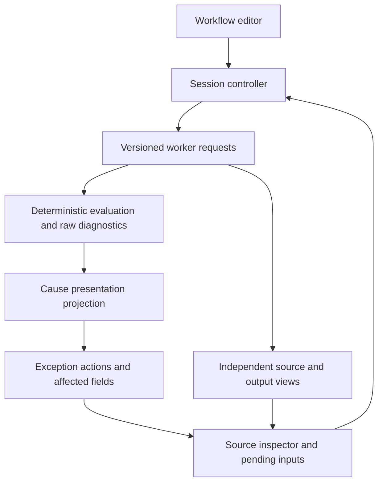
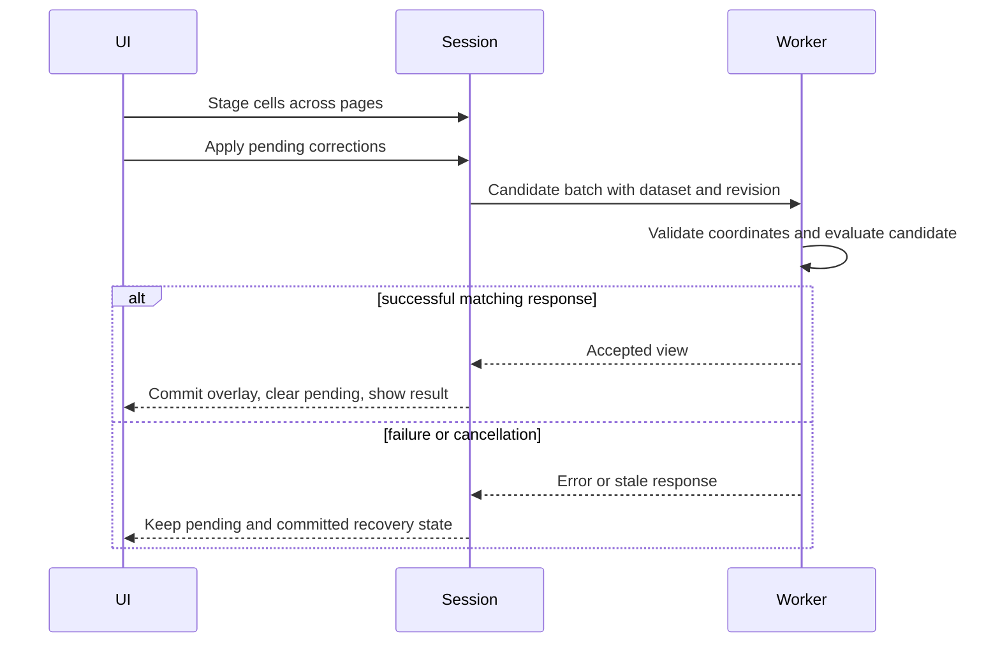
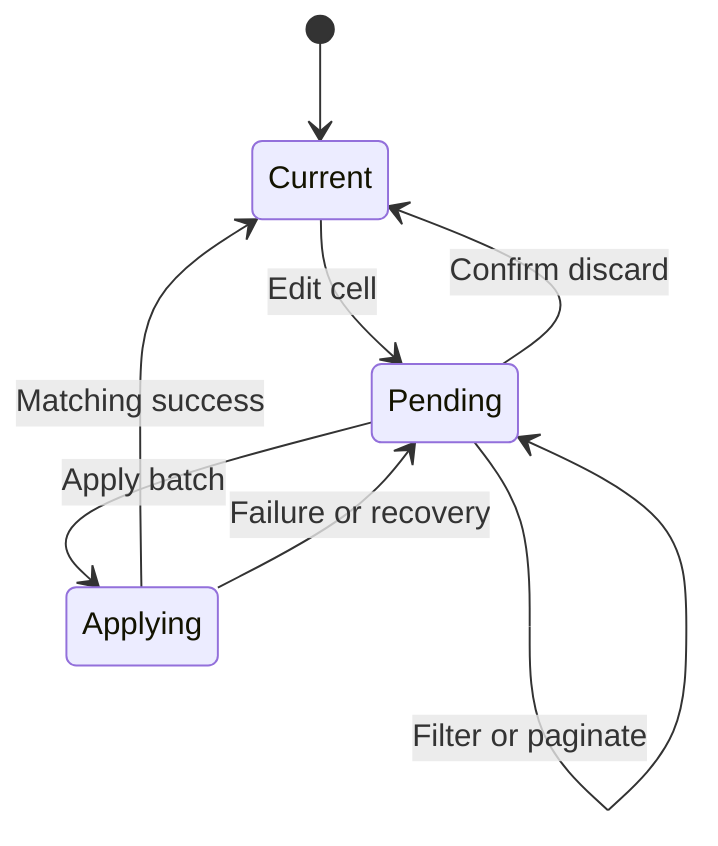

# Actionable exception review and batch corrections - Plan

## Goal Capsule

- Objective: Operators can find the source of an exception, correct several cells across a dataset, and confirm the resulting output without losing their work.
- Means: Structured exception causes, independent source inspection, and atomic session correction batches (KTD1–KTD3).
- Authority: Issue #14 owns these five acceptance fixes; `AGENTS.md`, `docs/PRD.md`, and the approved master plan continue governing existing product behavior.
- Execution: Start from U13 head `93ec73403b26aeddb5044c80534d30cca871dc96`, on a dedicated branch targeting `feat/u13-release-qualification`.
- Finish: Produce tested implementation and CE evidence in a draft PR. UX acceptance belongs to the user; merging, deployment, publication, and release are outside this work.

---

## Product Contract

### Summary

Implement all five required fixes in [issue #14](https://github.com/tamundrud/operations-data-cleaner/issues/14): exit editing, actionable exceptions, source-cell navigation, independent inspection filters, and staged batch corrections.

### Problem Frame

The current exception list repeats dependent failures and source inspection follows the output-preview page. Per-cell apply operations make corrections across many records cumbersome and obscure the source of failed calculations.

### Requirements

**Editor and exception review**

- R1. Saved/imported workflows offer Done editing, returning to repeat mode while retaining unsaved rules and ordinary validation/export gates; leaving editing does not save to IndexedDB.
- R2. Present root causes with affected output fields using structured source, operand, and rule provenance; only required-blank presentation symptoms explicitly caused by an upstream failure are suppressed.
- R3. Preserve complete raw diagnostics, invalid-row semantics, warning behavior, full-dataset counts, exclusion references, and export eligibility.

**Source inspection**

- R4. Exception actions open inspection, locate the original record/page, and focus/highlight implicated source cells with worksheet/record/line provenance; configuration failures identify or navigate to the relevant workflow setting.
- R5. Source inspection independently filters All source rows, Rows with exceptions, and Invalid rows only across the whole dataset, with separate pagination from output preview.
- R6. Keep original/current/session-corrected values inspectable, retain recently resolved records long enough to confirm the result, and make the next unresolved record reachable.

**Staging and preservation**

- R7. Cell edits stage across filtering and pagination without individual apply actions, with pending markers, Apply N corrections, and Discard pending changes near the source-table heading.
- R8. Apply one coherent correction batch with one revalidation; stale replies, failed batches, cancellation, and recovery cannot partially apply or overwrite newer state.
- R9. Pending edits block download, loss requires confirmation, and applying edits revokes partial-export acknowledgement and formula choice; successful application preserves correction context without forced scrolling.
- R10. Corrections remain session-only, preserve original file data and revert behavior, and do not enter workflow storage or portable JSON.
- R11. Unit and end-to-end regressions cover all acceptance examples, cross-browser CI, privacy interception, keyboard/mobile accessibility, exact exported data/bytes, and screenshots.

### Acceptance Examples

- AE1. Covers R2–R4, R7–R10. `examples/release/needs-correction.csv` identifies `Units=Twelve` as the offending operand; staging `12` and applying repairs ConvertedCases and counts without a duplicate required-blank presentation item.
- AE2. Covers R2–R4. One five-segment Address feeding four identical four-segment split rules yields one actionable problem with four affected outputs; raw issues remain available and the record stays invalid until repaired.
- AE3. Covers R3–R10. With at least 100 mixed rows and invalid rows after row 50, inspect/filter/navigate independently, stage across pages, apply once, and verify exact eligible output bytes and original provenance.
- AE4. Covers R1, R10. Enter and leave editing repeatedly after changing a saved/imported workflow; unsaved state survives and storage/portable workflow semantics remain correct.
- AE5. Covers R2–R4. Independently bad operands, unrelated required blanks, warning-only values, and configured-rule failures remain distinct and correctly targeted.

### Scope Boundaries

No new transformations, inferred values/types, drag-source-to-create-output, backend, telemetry, persistence of source records, deployment, or release. Preserve every applicable master-plan and PRD invariant. Do not add a general dependency graph or issue-text matching system; finite recipe provenance is sufficient for this release fix.

---

## Planning Contract

### Key Technical Decisions

- KTD1. Add structured runtime cause/operand metadata to engine issues and a presentation projection over raw diagnostics (R2–R4). Group by original row, source/operand or rule identity, diagnostic code, and relevant recipe configuration; never by message text. A split-family identity includes source, delimiter, expected count, trim and optional-empty policy, excluding only the selected output segment. Mark dependent required issues with an explicit upstream link. Numeric input parsing must identify every failed operand without interpreting policy failures such as nonterminating division as bad source data.
- KTD2. Keep pending edits in Session, separate from committed correction overlays (R7–R10). A batch request carries a candidate overlay and revision; worker validates every coordinate and evaluates before replacing its committed overlay/run. Session promotes recovery state only after the matching accepted view. Error/cancel/retry retain the prior committed overlay and pending edits. Reverts participate in the same batch rather than bypassing staging.
- KTD3. Add an independent source-query state and source result slice to the worker view (R4–R6). Filter the full run/source identities before slicing 50 rows; target navigation resolves an original row ID to its source page. Preserve output-query state during source requests and correction application. Retain newly resolved row identities for confirmation until an explicit source filter/navigation change, and offer next unresolved navigation.
- KTD4. Integrate with existing React/session revision scheduling and source overlay types (R1, R9–R11). Reuse `SourceCell.original` and Excel details. Do not change workflow schema version or serialize runtime cause/staging state.

### High-Level Technical Design

### Assumptions and System-Wide Impact

Existing native inputs, pagination, worker envelopes, and production-build test harness remain the implementation patterns. No new dependency is needed. This change spans engine metadata, worker/session transport, UI state, and export/loss guards, so the units are sequential despite some file-level separation. No cross-model authoring preference is configured.

External research is unnecessary for this bounded use of established local worker, overlay, and native-control patterns. Original Excel metadata preservation and integrated byte/privacy testing follow `docs/solutions/xlsx-qualification.md`. Exact control names, helper names, and responsive layout details remain implementation choices.

---

## Implementation Units

### U1. Explain actionable exception causes

- Goal: Deliver the projection and structured causes used by source navigation.
- Requirements: R2–R4, AE1–AE2, AE5; KTD1.
- Dependencies: Existing U13 engine.
- Files: `src/engine/issues.ts`, `src/engine/recipes.ts`, `src/engine/decimal.ts`, a focused cause-projection module if needed, `tests/unit/exception-causes.test.ts`, existing decimal/split/validation tests.
- Approach: Enrich diagnostics at their production boundary, preserve raw issue meaning, then derive review items and source/rule targets.
- Patterns to follow: Existing `NumericError`, `ResultRow.issues`, `SourceTable` identity, and independent recipes.
- Execution note: First prove duplicate split/required presentation and lost calculation operand identity with focused failing tests.
- Test scenarios:
  1. AE1 and AE2 preserve raw error counts/invalidity while producing the requested actionable items.
  2. Two bad operands both remain identifiable; different split policies and unrelated required blanks do not merge.
  3. A zero constant divisor, rounding/precision policy failure, and warnings have appropriate rule/source targets without invented source fixes.
- Verification: Cause tests and existing unit regressions pass without changing exported values or row status.

### U2. Make source batches atomic and independently paged

- Goal: Support coherent multi-page correction and independent source queries.
- Requirements: R5–R10, AE3; KTD2–KTD3.
- Dependencies: U1.
- Files: `src/session/controller.ts`, `src/session/worker-protocol.ts`, `src/session/correction-overlay.ts`, `src/processing.worker.ts`, `tests/unit/session.test.ts`, `tests/unit/corrections.test.ts`, focused worker/browser integration tests.
- Approach: Extend the existing request envelope and view, replace the repository-internal single-cell mutation path, and preserve committed recovery state until batch success.
- Patterns to follow: Existing request/dataset/revision checks, worker import candidate handling, original literal overlays, 50-row views.
- Execution note: Capture stale/failure/recovery and independent pagination failures before production changes.
- Test scenarios:
  1. Stage two cells on different pages, apply once, and observe exact updated outputs/counts with unchanged originals.
  2. Source filtering/pagination/target navigation does not change output selection or lose staged edits.
  3. Invalid coordinates or failed evaluation do not partially commit; stale replies and cancel/retry cannot install candidate edits as committed recovery data.
  4. Pending edits block export, discard restores ordinary gates, and applied changes invalidate acknowledgement.
- Verification: Session/overlay tests plus real worker integration pass with complete row/provenance identities.

### U3. Integrate editor and correction journeys

- Goal: Expose the five fixes through accessible controls.
- Requirements: R1–R10, AE1–AE5; KTD4.
- Dependencies: U2.
- Files: `src/ui/Workspace.tsx`, `src/ui/SourceCorrection.tsx`, `src/ui/styles.css`, `tests/e2e/correction-reupload.spec.ts`, `tests/e2e/partial-export.spec.ts`, `tests/e2e/release.spec.ts`, `tests/e2e/issue-14.spec.ts`.
- Approach: Add Done editing and unsaved messaging, grouped review/actions, independent source controls, staged inputs and batch actions. Confirm pending loss on new/replaced workflow or source, disclosure/page exit paths that discard drafts, and browser unload. Preserve original/revert inspection and focus only when navigation is explicit.
- Patterns to follow: Native labels, existing confirmation semantics, auto-run generation guards, Excel cell details, and source table horizontal scrolling.
- Execution note: Update meaningful existing browser assertions for batch semantics and add focused missing journeys before implementation.
- Test scenarios:
  1. AE4 survives repeated editing exits without implicit save or new export authorization.
  2. AE1–AE3 highlight/focus correct cells including worksheet/off-page records; rule failures identify settings.
  3. Pending markers/actions survive source filters/pages, cancellation of loss confirmation preserves pending values, and successful apply keeps correction context.
  4. Keyboard/mobile controls and status feedback pass accessibility checks at desktop and narrow widths.
- Verification: Exact downloads, provenance, pending-loss guards and accessibility journeys pass through the production build.

### U4. Qualify the draft for UX acceptance

- Goal: Supply reproducible evidence for the complete change.
- Requirements: R11 and all acceptance examples.
- Dependencies: U3.
- Files: `tests/e2e/privacy.spec.ts`, release/performance/portability regression suites, `.github/workflows/u2.yml` only if required for the existing browser matrix, `docs/reviews/issue-14/` evidence and screenshots.
- Approach: Run the established unit/build/static and full browser suites, inspect desktop/mobile screenshots, complete CE simplification/code review, and record limitations honestly.
- Patterns to follow: Existing U13 evidence and Chromium/Firefox/WebKit CI matrix.
- Test scenarios:
  1. Synthetic correction sentinels never leave the browser or enter workflow persistence/backup.
  2. Existing 10,000-row CSV/XLSX, byte/type fidelity, formula safety, saved reuse and portability regressions remain passing.
  3. CI covers every browser and retains reports/traces/screenshots.
- Verification: Required checks pass or genuine environment blockers are named; no acceptance-complete claim substitutes for the user's UX acceptance.

---

## Verification Contract

Use `npm run typecheck`, `npm run lint`, `npm run test:unit`, `npm run build`, and the full production-build `npm run test:e2e` matrix for Chromium, Firefox and WebKit. Existing privacy and performance suites remain required. New tests must inspect actual source/output/counts and download bytes, not screenshots alone. Capture focused red/green proof, current source identity, browser/accessibility/privacy reports, desktop/mobile screenshots, and CE review outcomes under `docs/reviews/issue-14/`.

---

## Definition of Done

All five issue fixes and AE1–AE5 are implemented without weakening raw validation, data fidelity, privacy, row identity or workflow compatibility. Regression checks and CE reviews have evidence tied to the reviewed code. Remove abandoned implementation attempts. Create a dedicated draft PR targeting `feat/u13-release-qualification`, attach evidence and clear UX review instructions, and leave it unmerged for the user's acceptance.
