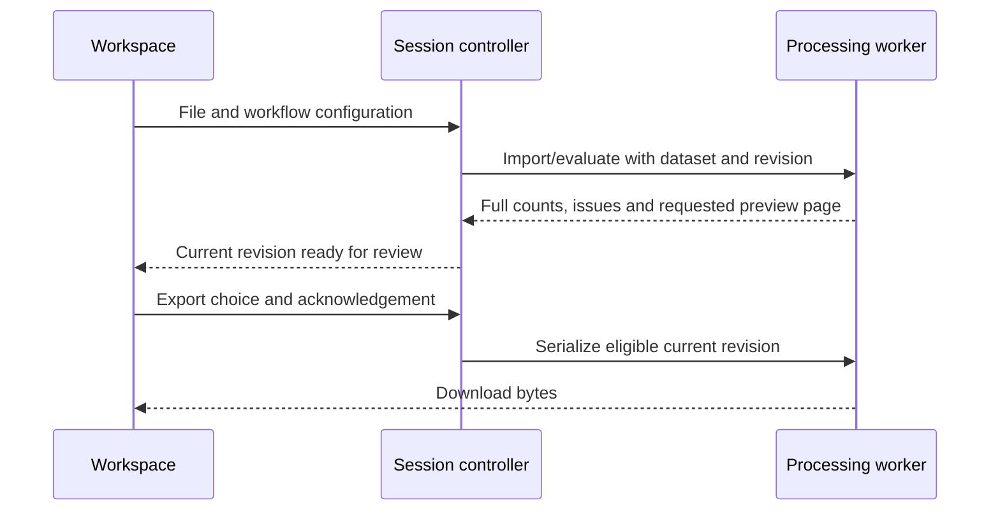
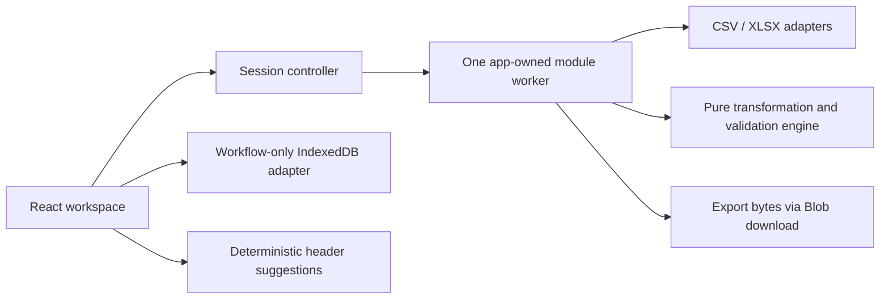
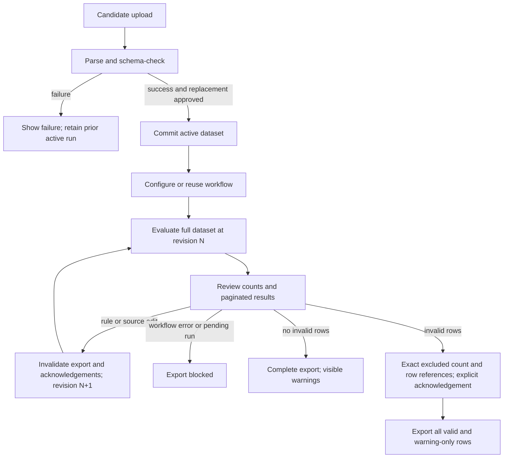

# Operations Data Cleaner - Plan

## Goal Capsule

Deliver the browser-only MVP specified in [PRD v0.2](../PRD.md). Begin with a bounded Excel feasibility gate before substantial application work, then demonstrate CSV conversion, constants, saved workflow reuse and logistics-aware suggestions before advanced transformations and Excel integration. Architecture, stack, product scope and safeguards are approved in principle; this revision does not authorize implementation or publication.

The repository currently contains documentation, fixtures directories, and repository policies, but no application stack. Preserve the existing Apache-2.0 license, synthetic-data-only policy, byte-preserving CSV attributes, and focused-branch/PR practices in [AGENTS.md](../../AGENTS.md).

---

## Product Contract

### Summary and problem frame

Help an ordinary spreadsheet user repeatedly convert customer order exports into a user-defined TMS import table without transmitting customer data. Success means reliable files and understandable exceptions, not vendor-certified interoperability, traffic, or commercial traction.

### Binding requirements

The PRD owns product behavior and acceptance examples. The following IDs organize delivery; they do not replace or weaken the referenced requirements.

| Plan ID | Binding PRD requirements | Delivery concern |
| --- | --- | --- |
| R1 | FR-01–06, FR-35–37 | CSV/XLSX input, destination definition, row and cell fidelity |
| R2 | FR-07–10, FR-38–39 | Graphical independent recipes, confirmed suggestions, compatible headers |
| R3 | FR-12–17, FR-40–41, FR-43 | Constants, trim, split/combine, arithmetic, dates |
| R4 | FR-19–25, FR-44 | Full-dataset validation, corrections, acknowledged exclusions |
| R5 | FR-29–34, FR-46 | Ad hoc use, versioned local workflows, portable backup, synthetic examples |
| R6 | FR-27–28, FR-45, FR-47 | Preview, output bytes/types, explicit spreadsheet safety |
| R7 | NFR-01–06 | Local processing, ephemeral source data, hostile-content protection |
| R8 | NFR-07–10 | Responsiveness, 10,000-row qualification, round trips and counts |
| R9 | NFR-11–14 | Desktop-first, accessible visual controls and actionable messages |
| R10 | NFR-15–16; PRD §11 | Same hosted/local app, documentation and public demonstration |

PRD §14.1 remains binding: one candidate per original nonblank row, independent output recipes, source-only session edits, normalized-header matching, no inferred conversions, no silent rounding/cleanup, and explicit safe-versus-raw CSV handling. Preserve the browser-only and visual-first boundaries throughout.

### Scope and optional capabilities

Implement every MUST requirement and AC-01–22. Defer FR-11 suggestion explanations, FR-26 downloadable exception reports, and FR-42 exact-match replacements/AC-23 to a follow-on release. On-screen exception counts and excluded-row references remain mandatory. Do not create extension machinery for these deferred features.

No backend, accounts, cloud storage, AI, telemetry, arbitrary expressions, plugins, joins, aggregation, row expansion, destination overrides, locale guessing, or proprietary TMS certification. Mobile editing is not a release requirement. Early slices are internal demonstrations, not the complete MVP.

---

## Planning Contract

### KTD-01 — Small static application and dependency policy

Use React with strict TypeScript, Vite, and ordinary CSS. A single workspace and local navigation state are enough: no router, state-management package, UI framework, server runtime, or service worker. Use native labelled controls and paginated tables rather than a spreadsheet-grid dependency.

Use npm with a committed lockfile and a supported Node LTS development environment; record the exact versions in U2. Add dependencies only when their unit needs them:

| Dependency | Purpose and rationale | Qualification |
| --- | --- | --- |
| Papa Parse | CSV quoting/delimiter handling; keep records as arrays | Disable automatic typing, header-object conversion, and implicit blank-row skipping. [Official documentation](https://www.papaparse.com/docs) notes automatic duplicate-header renaming in header mode; that behavior must not hide invalid headers. |
| Zod | Runtime validation of finite, versioned workflow JSON; inferred TypeScript types | Strict objects/discriminated variants; separate semantic checks. [Official documentation](https://zod.dev/) |
| big.js | Decimal operations from strings | Addition/multiplication are exact; division needs the explicit policy in KTD-04, not a global precision guess. [Official repository](https://github.com/MikeMcl/big.js/) |
| SheetJS Community Edition | XLSX metadata-aware reader and value-only writer | Pin the official distribution, verify integrity and applicable advisories before adoption. Official installation documentation currently identifies 0.20.3 while the public npm `xlsx` package is outdated; do not install that stale package by default. Bundle locally, never load a runtime CDN. [Official installation guidance](https://docs.sheetjs.com/docs/getting-started/installation/nodejs/) |
| fflate, conditional on U1 | Candidate for bounded ZIP handling if the selected XLSX reader lacks adequate protections | Qualify only if needed; do not add it to the application by default. [Official repository](https://github.com/101arrowz/fflate) documents streaming ZIP support, not proof that a custom preflight/reconstruction layer is necessary or sufficient. |
| Vitest and Playwright | Pure engine/format tests and real browser/download/privacy tests | Test the production build; no snapshots-only acceptance. |

Check licenses, provenance, security advisories, and browser/build compatibility at introduction. Pin approved versions; a lockfile alone does not qualify a vulnerable dependency. Keep third-party notices. No dependencies have been installed or experimentally qualified during this planning turn.

### High-level technical design

The sketches below and the recipe/model tables are directional contracts, not prescribed component names or implementation code. They cover component ownership, worker protocol, session states/lifecycle, data flow, export decisions, option combinations and the finite recipe grammar. The KTDs own their detailed rules.

Worker protocol (KTD-02/05):



Session states (KTD-05; successful replacement commits a new dataset, failure keeps the old one):

```mermaid
stateDiagram-v2
  [*] --> Empty
  Empty --> Importing: upload
  Importing --> Draft: compatible table
  Importing --> Empty: failure with no prior run
  Draft --> Processing: valid configuration
  Processing --> Review: current result
  Review --> Processing: correction or rule change
  Processing --> Draft: workflow error
  Review --> Importing: replacement candidate
  Importing --> Review: replacement failed; prior run retained
  Review --> Empty: end session
```



Value data flow (KTD-03/04):


Export option combinations (KTD-05–07):

| Format | Invalid rows | Formula-like text | Eligibility |
| --- | --- | --- | --- |
| CSV | None | None | Complete export |
| CSV | None or some | Present | Current safe/raw choice required; partial acknowledgement also required if invalid rows exist |
| CSV/XLSX | Some | Any | All eligible rows only after current exact-exclusion acknowledgement |
| XLSX | None | Present | Complete export with literal string cells |
| Either | Workflow error, pending result, or no eligible rows | Any | Blocked |

### KTD-02 — Engine boundary, worker and file layout



`src/engine/` accepts workflow configuration, parsed source data and correction overlays, and returns candidate records/issues. It has no React, DOM, storage, network, or workbook-library dependency. Format adapters translate cells and bytes at its boundary. The worker owns source cells and computed results; the UI receives summaries and requested pages, not a second full table for rendering.

Use a small tagged message protocol for import, run, correct, page, export and cancel. Every request/result carries dataset identity and revision. No generic RPC framework. Terminate/recreate a worker for cancellation of a synchronous parser; never export an incomplete run. The session controller retains the active File handle, import settings, dataset identity, working workflow and correction overlay in memory, but not a second parsed table. After worker termination/crash, reparse that active File and replay the overlay before restoring review/export. A candidate replacement has separate recovery state and cannot replace the active File or clear corrections until successfully committed; invalidate old export acknowledgements during recovery.

Resource lifecycle:

| Resource | Creation/use | Replacement/recovery | Session end |
| --- | --- | --- | --- |
| Active File and correction overlay | Controller memory; worker evaluates effective cells | Retained until replacement commits; replay after worker restart | Released; never persisted |
| Parsed cells and candidate results | Worker memory for current dataset/revision | Rebuilt after cancellation/crash; superseded replies discarded | Worker terminated and memory released |
| Named workflow configuration | Draft in memory; IndexedDB only on explicit save | Versioned codec; failed save leaves draft intact | Only explicitly saved configuration survives |

Proposed layout, created only during implementation:

```text
src/
  engine/       workflow, values, recipes, validation, issues
  formats/      csv, xlsx, spreadsheet-safety; archive-budget only if U1 justifies it
  session/      controller, worker-protocol, correction-overlay
  workflows/    codec, indexeddb-store
  suggestions/  dictionary, matches
  ui/           workspace, recipe-editor, review, saved-workflows
  processing.worker.ts
tests/
  unit/         domain and adapter contracts
  e2e/          user journeys, downloads, privacy, performance
  fixtures/     synthetic inputs and expected bytes/workflows
docs/decisions/ documented material choices during implementation
```

### KTD-03 — Core models and declarative workflow version 1

Define the complete finite MVP grammar in U2. A build supports only its delivered recipe variants; imported configurations needing a later capability fail clearly rather than execute partially. Do not build a plugin registry or migration framework. Version 1 is the first supported version; future/unknown versions are rejected. Any later supported migration must be explicit and golden-tested.

| Model | Required contents and invariants |
| --- | --- |
| Workflow | Format version; configuration identity and optional draft name (name required on Save); source format settings and referenced normalized headers; ordered destination fields; CSV/XLSX output settings. Only configuration, never source filenames/rows, sample values, session revisions or row IDs. |
| Destination field | Stable internal ID, output header, expected text/number/date type (default text), required flag (default optional), optional maximum text length/whole-number/scale rules; one primary recipe; explicit trim/date modifier and rounding settings when applicable. Unfinished mappings are draft state, not exportable workflows. |
| Source column | Position, literal display header, normalized matching key. Normalization is boundary trim, internal-whitespace collapse and deterministic case-folding; blank/duplicate keys block. Preserve literal header separately. |
| Source cell | Raw kind/value, original display text, workbook format/date-system information when applicable; formula presence and cached-result provenance. CSV starts as text, not auto-inferred numbers/dates. |
| Source row | Stable identity tied to dataset and original record position; immutable original cells; CSV logical record and physical starting line, or worksheet name and original Excel row. Embedded newlines do not break row references. |
| Typed result value | Blank, text, exact decimal string, or calendar date with year/month/day. Errors are issues, never `NaN`, guessed dates or sentinel strings in export. |
| Correction overlay | Source row ID/column key to explicit replacement value; originals stay inspectable. Memory only; no changes to the uploaded file. |
| Field result/provenance | Destination field ID, typed value, referenced source cells/constants, applied modifiers and use of corrected/cached input. No output-to-output dependencies. |
| Issue | Stable code, workflow/row scope, error/warning severity, row/field/source references, plain-language reason and next action. Row status derives from issues. |
| Run summary | Input data rows, skipped original blank rows, candidate rows, valid/warning-only/invalid row counts, issue counts, distinct corrected rows and exclusions. Counts cover the complete dataset. |
| Export request | Current run revision, format/options, CSV risk choice, and partial-export acknowledgement when needed. Reject stale or unfinished requests. |

Finite recipe grammar:

| Primary tag | Configuration |
| --- | --- |
| Copy | One source column key |
| Constant | Typed text, exact decimal literal, or intentional blank |
| Split | One source column; literal delimiter; expected segment count; selected segment index; explicit segment trimming and optional-empty positions |
| Combine | Ordered list of at least two source/literal components; literal separator; retain empty components (no hidden suppression) |
| Calculate | One of add/subtract/multiply/divide; two operands, each source reference or exact decimal constant |

Output modifiers are limited to explicit text trim and explicit source-to-target date format conversion. Validation/number precision are field settings, not general operation chains. Reject incompatible combinations, missing references, duplicate field IDs and malformed variants before a run. Strict JSON decoding must reject unexpected properties instead of stripping executable-looking content and continuing. Impose bounded JSON size/depth/field counts; never evaluate strings, HTML or code.

Interfaces are data contracts, not framework abstractions: import returns source metadata/rows or an actionable failure; workflow validation returns blocking configuration issues; row evaluation returns field values/provenance/issues; dataset evaluation returns full counts and results; serialization accepts only a current eligible run. The storage adapter reads/writes validated workflow configuration only.

### KTD-04 — Deterministic value interpretation

Evaluate primary recipe, explicitly configured output trim/date interpretation, numeric precision policy, then validation. Validate whole-number requirements on the exact arithmetic result before rounding so fractional cases cannot be disguised. A blank optional copied/constant value does not fail merely for absence; missing arithmetic operands, failed splits and unusable referenced formula caches remain errors even for optional outputs.

Numeric conversion uses a documented strict decimal grammar: sign, decimal digits and optional decimal point; no guessed currency, thousands separators, units or locale. Keep operands/results as decimal strings. Use big.js for arithmetic, with a narrow integer-rational check for division: reduce the ratio and determine whether the denominator has only factors 2 and 5. Exact terminating division uses its required scale; nonterminating division without an explicit rounding rule is invalid. Precision excess likewise fails unless explicitly configured. Offer “Round half up,” “Round half to even,” and “Truncate toward zero,” each with decimal places and a visible example. Never let a library default decide business rounding. Defend against pathological digit/exponent sizes with documented resource limits.

Date parsing supports the three required patterns using strict calendar validation and a plain calendar-date representation, not `Date.parse` or timezone conversion. Excel input honors the 1900/1904 epoch; reject impossible serial dates including the fictitious 1900-02-29. Do not silently discard a time component when interpreting a cell as a date-only value; explain unsupported datetime input. Preserve raw/display values for inspection.

Text copy preserves content unless an explicit rule changes it. Excel numeric-to-text copying uses safely supported display formats (including all-zero padding such as `000000`); unsupported identifier formats and suspicious precision get warnings. Arithmetic uses raw numeric value, not currency-formatted display text. Warn that digits already lost in Excel cannot be recovered.

### KTD-05 — Session state, counts and export eligibility



Parse a replacement before committing it; ask before discarding active corrections and preserve rules. Failed replacements leave the prior dataset intact. Recompute the affected whole row after a source edit; recompute the dataset after a rule change. Discard worker replies for older revisions. Export and preview must refer to the same finalized revision/options. CSV safety and partial-export acknowledgements are tied to that revision, not treated as permanent permission saved in a workflow.

Candidate rows equal original nonblank source rows. Candidate count equals valid + warning-only + invalid; skipped blanks are separate. Preserve an original candidate row even if a correction clears all its cells. Report warning-row counts separately from warning-issue counts. Count distinct currently corrected rows, not keystrokes. A zero-eligible-row partial export is blocked with a useful action rather than producing a misleading empty file.

### KTD-06 — CSV contract and spreadsheet safety

Decode UTF-8 strictly (including optional BOM); fail on malformed bytes. Parse arrays without type inference or automatic blank skipping; inspect the first nonblank record as headers. Distinguish parser end-of-file artifacts from actual blank records in fixtures. Block malformed quoting and unexpected extra cells rather than silently truncate; preserve short rows as missing cells so validation can identify missing data. Verify detected comma/semicolon/tab delimiter or let the user select it. Template imports inspect names/order only.

Serialize the PRD default UTF-8/no-BOM/comma/header/CRLF and standard quoting; U3 adds the required settings. Raw mode preserves logical text exactly, including leading zeros and whitespace; normal CSV escaping is still required and is not preservation of the entire original source file.

Scan output text cells and headers for formula-like prefixes, including `=`, `+`, `-`, `@`, tabs, carriage returns and leading-whitespace/control variants. Typed negative numbers are not unsafe text. If risk exists, show affected fields/rows and require a choice: prefix risky text with an apostrophe for escaped output, or preserve raw text with an explicit warning against opening it in spreadsheets. Show the changed export representation before download. Do not promise that one CSV escape policy protects every spreadsheet/importer; raw TMS fidelity and spreadsheet interpretation are distinct. Apply this policy to constants/combined text/header labels as well as copied values. Excel output uses literal string cells instead.

### KTD-07 — XLSX qualification and resource safety

**U1 mechanism resolution:** [Excel qualification decision](../decisions/excel-fidelity.md) selects SheetJS CE 0.20.3 with native streaming bounded ZIP preflight. Preflight is required; archive reconstruction and a production fflate dependency are not needed for the qualified profile. U9/U10 must repeat this qualification in the integrated worker.

Use original cell type/value/display/format/formula metadata, not a flattening conversion that loses provenance. Never execute formulas; usable cached results carry stale-cache warnings to dependent output, while missing/unusable referenced caches produce row errors. Do not render imported HTML, activate hyperlinks, or fetch external workbook relationships.

Read only one user-selected worksheet and an ordinary first-nonblank-header table. Reject unsupported/encrypted formats and malformed archives clearly. U1 must establish an adequately safe resource-protection approach before substantial application work. First qualify the reader's existing controls and the smallest browser-side guard; add bounded ZIP preflight only if evidence identifies an uncovered risk, and archive reconstruction only if evidence shows it is needed beyond that preflight. Declared uncompressed sizes alone are not evidence against a ZIP bomb. A worker provides responsiveness, not a secure memory sandbox. Qualify actual expansion/allocation behavior, forged lengths, corrupt archives, duplicate/path-conflicting entries, cancellation and malicious worksheet dimensions. The selected approach must reject unsafe inputs without silently truncating meaningful data. If no bounded, maintainable approach meets the PRD, stop at U1 and escalate the blocker rather than defer Excel or weaken safeguards. U9/U10 repeat qualification in the integrated application before enabling XLSX.

Initial engineering guards: 25 MiB source files, 100 MiB actual expanded workbook data, 2 million inspected table cells, bounded JSON and decimal sizes, and a cancellable processing watchdog. These are provisional resource budgets, not a 10,000-row cap. Measure representative 10,000-row fixtures and adjust budgets with documented evidence before release; show exact limit/remediation rather than silently omit data.

Write a new value-only workbook with selected columns/types. Never copy source formulas, hyperlinks, rich HTML, macros or external relationships. Text is a string cell even when formula-like. Numeric output must round-trip to the intended decimal value under the workbook numeric representation; values that cannot be represented faithfully become export errors, with CSV/text-type alternatives explained rather than silently coerced. Date output uses a deliberate workbook epoch and date number format without timezone conversion. Preserve blanks and output column order.

### KTD-08 — Workflow-only persistence and portability

Use native IndexedDB behind one adapter; do not introduce a database framework for a small configuration collection. Explicit Save commits validated configuration. Rule edits remain a working draft until saved. Read failures, quota exhaustion, blocked storage and corrupt records get actionable messages; ad hoc processing and portable download must remain usable when storage fails.

Portable JSON and stored workflows use the same versioned codec. Import validates before altering anything. Name/identity collisions require explicit replace or save-copy choice, never an automatic overwrite. First successful save shows a nonblocking backup prompt; Download workflow remains visible. Warn that browser storage is clearable/browser-specific and constants/field names can be sensitive. Do not persist recent file names, datasets, corrections or preview samples anywhere, including localStorage, IndexedDB and service-worker caches.

### KTD-09 — Visual workspace and suggestions

U2 follows the [approved paired-card specification](../design/u2/paired-cards/SPECIFICATION.md) and [implementation addendum](2026-10-14-u2-paired-card-matching.md). Matched source/output cards share a row above unmatched sources and outputs. Match in either drag direction or by selecting counterparts; reuse sources, unlink and reorder complete pairs. Matching preserves schema order; explicit pair reorder permutes matched slots. Keep all-column movement, rename/remove, native source choice and validation in contextual controls. Automatically refresh through the existing revision-safe debounce scheduler; block stale/incomplete exports. Inspect original source rows in a secondary disclosure. No connector lines, node graph or persistent row forms. Confirmed/suggested/unmapped states use text as well as color.

Keep preview to paginated pages (initially 50 rows), with full counts always visible and filters/navigation for every exception. Basic keyboard navigation, focus/error announcements and laptop layouts are part of every unit, not late polish. Daily operators see saved-workflow upload/review/export first; opening the editor is optional.

After U2's first working visual interface, review the complete upload → map → preview → export journey before accepting the slice or proceeding to U3. Use synthetic files and an operator with basic spreadsheet skills; ask them to map, rename/reorder, inspect output and download without mandatory onboarding, code or an explanatory walkthrough. Check obvious next actions, source-versus-output distinction, unmapped/error states, visible export settings/safety choice and keyboard operation. Record observed friction and agreed corrections; fix material discoverability/accessibility blockers and rerun the journey. A passing automated download test alone does not close this UX checkpoint. Request user review when a suitable operator is unavailable rather than inventing usability evidence.

Suggestions are a separate deterministic header-only function: exact normalized matches plus a small curated dictionary, with human confirmation. Initial positive pairs include `Ship To`/`Consignee` and `PO #`/`Purchase Order Reference`; ambiguous duplicates remain alternatives. Negative fixtures distinguish billing party from consignee, purchase order from sales order, shipment ID from stop ID, and quantities with different units. Do not use fuzzy substitution on repeat runs, inspect row data for suggestions, or auto-confirm. Reasons are deferred under FR-11.

### KTD-10 — Privacy, performance and operational constraints

Ship only bundled same-origin assets; no remote fonts, runtime CDN imports, telemetry, crash reporters or background services. Production CSP blocks network connections and active content: self-only scripts/workers/styles, `connect-src 'none'`, `object-src 'none'`, `base-uri 'none'`, and `form-action 'none'`; permit local Blob downloads and images only as needed. Prefer host response headers and also test the actual deployed policy. Dev tooling traffic is not the production privacy acceptance environment.

No source values/filenames/record IDs in URLs, console logs, error reports or diagnostic requests. Render untrusted strings as text. Local sample assets use fixed paths and synthetic content. A static host's ordinary request metadata is separate from source-data processing and must be described honestly.

Proposed acceptance environment: current stable desktop Chromium on a documented four-core-or-better, 8 GiB laptop; record actual OS, CPU, browser and production build hash. Also run functional/browser checks in Firefox and WebKit. Engineering targets: under-500-row CSV import-through-ready-preview within 1 second; 10,000 rows × 20 representative columns, full CSV import/process/export within 5 seconds and XLSX within 15 seconds; single-row correction within 200 ms; busy-state controls respond within 100 ms. Measure median and worst of five warm runs plus one cold run. These are proposed budgets, not measured claims. CI runs correctness/responsiveness smoke checks; reference-device timing is recorded before release. Keep the UI interactive, show stage/busy status and cancellation, and never apply a row cap to make a benchmark pass.

### Risks, dependencies and approval boundaries

| Risk/dependency | Response and stop condition |
| --- | --- |
| Excel fidelity, compressed archives and cached formulas | U1 gates substantial implementation; U9/U10 repeat integrated qualification. Choose the simplest approach with evidence; no claim that worker isolation or a library name proves safety. Inability to meet MUST behavior is a blocker requiring resolution, not deferral of Excel. |
| CSV raw fidelity conflicts with spreadsheet opening | KTD-06 preserves the settled explicit-choice decision; test changed/raw bytes and warning visibility. |
| Decimal/date interpretation can silently change meaning | KTD-04 finite explicit formats and error cases; no generic locale parser or floating-point shortcut. |
| Browser storage is unreliable/clearable | KTD-08 independent portable backup, localized failures, no source persistence. |
| First vertical slice requires foundational contracts | U2 keeps the foundation attached to a runnable conversion, not a standalone platform project. |
| Resource/timing proposals need measurements | User approves these engineering targets with the plan; revise using recorded evidence if ordinary 10,000-row use is excluded. |
| Hosting target and domain not selected | Build portable static assets and document CSP headers. Choose deployment destination and obtain publication approval at U13; not a blocker for U2. |

The stack, scope and safeguards are approved in principle; the revised sequence advances recurring-use value. Performance/resource targets remain provisional pending U1 and integrated measurements. U1 is ready as the first execution target when separately authorized; its pass is required before U2. No unresolved product decision requires reopening discovery. Material feasibility blockers, missing MUST behavior, relaxed fidelity/privacy protections or a library/architecture change require user approval. Completing this revision does not start ce-work.

---

## Implementation Units

### Unit index

Unit numbers are deliberately reassigned in this revision at the user's request; use the current numbers below. U1 is a limited qualification task, not an application feature slice. U2 is the first working vertical slice and includes the day-one synthetic source/template/workflow requirements.

| Unit | Demonstrable outcome | Primary paths | Dependencies |
| --- | --- | --- | --- |
| U1 | Early XLSX feasibility decision with qualification evidence | `tests/qualification/xlsx/`, `docs/decisions/excel-fidelity.md` | None |
| U2 | Reliable CSV mapping and download; early UX checkpoint | `src/engine/`, `src/formats/csv.ts`, `src/ui/workspace.tsx` | U1 |
| U3 | Fixed fields, trim and CSV options | `src/engine/recipes.ts`, `src/ui/recipe-editor.tsx` | U2 |
| U4 | Save, reopen and portable workflows | `src/workflows/`, `src/ui/saved-workflows.tsx` | U3 |
| U5 | Confirmable logistics suggestions | `src/suggestions/`, recipe editor | U4 |
| U6 | Strict split and ordered combine | Same recipe/editor boundaries | U5 |
| U7 | Exact arithmetic and numeric rules | `src/engine/decimal.ts`, `src/engine/validation.ts` | U6 |
| U8 | Explicit dates | `src/engine/dates.ts` | U7 |
| U9 | One-sheet Excel-to-CSV | `src/formats/xlsx.ts`; resource adapter only if justified by U1 | U1 and U8 |
| U10 | Typed Excel downloads | `src/formats/xlsx.ts` | U9 |
| U11 | Source correction and safe replacement | `src/session/correction-overlay.ts`, `src/ui/review.tsx` | U10 |
| U12 | Acknowledged partial export | `src/session/controller.ts`, `src/ui/review.tsx` | U11 |
| U13 | Qualified public-release candidate | `README.md`, `docs/`, integrated browser tests | U12 |

### U6. Strict split and ordered combination

**Goal:** Split a logistics address into independent target fields and combine configured fields/literals visually.

**Requirements:** R3; FR-13–14,38; AC-03–04. **Dependencies:** U5. **Files:** recipes/editor; `tests/unit/split-combine.test.ts`; `tests/e2e/address-recipes.spec.ts`; synthetic address fixtures.

**Approach:** KTD-03/04; each split destination reads the original source, not another result. Expose delimiter/count/segment/optional-position/trim; retain combine empties.

**Test scenarios:** Four-part address yields four trimmed fields only when requested; fifth/missing required segment is invalid; configured empty optional position remains unambiguous. Combine ordering/literals/separator and empty positions are exact. Unsupported recipe dependencies are rejected.

**Verification:** Source→transformed download, exception row/field references and workflow schema tests; existing privacy/10,000-row smoke tests.

## Verification Contract

Each unit introduces its own executable tests. Subsequent units run earlier tests; no mock-only format, schema or privacy acceptance. Use synthetic fixtures exclusively and preserve CSV byte attributes already in the repository.

Execution checkpoints: U1's recorded feasibility pass precedes substantial application work; U2's observed UX checkpoint precedes acceptance of the first visual CSV slice. U4 demonstrates save/reopen/backup/reuse with simple CSV recipes; U5 demonstrates suggestions and persistence of confirmed mappings. U6–U10 must extend storage/portable round-trip tests for each newly delivered recipe, modifier, validation or format setting. A gate's limited probes never replace full production-build privacy tests or integrated release acceptance.

| Acceptance scenarios | Primary unit(s) | Evidence |
| --- | --- | --- |
| AC-08–09,17 XLSX qualification | U1; acceptance repeated in U9/U10 | Early fidelity/date/formula/resource evidence and simplest-approach decision; not full acceptance |
| AC-01,11,22 baseline | U2 | Real sample/manual mapping and exact download/counts |
| AC-02 | U5 | Accepted/rejected suggestions and negative dictionary cases |
| AC-03–04 | U6 | Explicit split/combine outputs and row errors |
| AC-05–06,10 | U7 | Exact decimal strings, invalid operands and rounding boundaries |
| AC-07 | U3 | Typed fixed values and intentional blanks |
| AC-08 | U2,U9,U10 | CSV/XLSX identifiers and uncertainty warnings |
| AC-09 | U8–U10 | Explicit patterns, epochs, calendar/type fidelity |
| AC-12,18–19 | U4 | Header compatibility, saved/portable meaning and safe failures |
| AC-13–14 | U11 | Original/edited provenance, replacement and stale-reply protection |
| AC-15 | U12 | Eligible download set, exact exclusions and acknowledgement |
| AC-16 | U2,U3 | UTF-8/BOM/delimiter/header/quoting/CRLF byte goldens |
| AC-17 | U2,U9,U10 | CSV choices, no formula execution and literal Excel cells |
| AC-20 | U2 onward | Production-context request interception at every added stage |
| AC-21 | U2 onward; full U13 | 10,000-row completeness/responsiveness and measured timings |
| AC-22 full demonstration | U13 | Sample logistics workflow with all released capabilities |
| AC-23 | Deferred | Required only if FR-42 is later included |

Proposed real scripts established in U2: `npm run typecheck`, `npm run test:unit`, `npm run build`, `npm run test:e2e`, `npm run test:privacy`, `npm run test:performance`. Browser tests use a production build served locally, not development/HMR output. Build/test commands are planned, not available or run in this documentation-only repository today.

Privacy tests install interception on the whole browser context before application load; block service workers; allow only known static asset paths/methods, and fail any other request, beacon, fetch, XHR, form submission or WebSocket attempt. Inject distinctive sentinels in file bytes, names, record IDs, corrections and constants; inspect outgoing URLs/headers/bodies and console/diagnostics. Exercise all added stages and storage/portable JSON exclusions. [Playwright's network documentation](https://playwright.dev/docs/network) explains why context-wide interception and service-worker handling matter. CSP is checked independently, not used instead of observed network assertions.

Domain tests cover repeatable evaluation, header normalization collisions, candidate/count identities, recipe independence, all decimal/date failure branches and workflow semantic validation. Property-based-style generated loops can use deterministic seeded fixture builders; no extra testing dependency is necessary initially. Adapter tests include malformed bytes/quotes, quoted multiline provenance, workbook raw/display/type distinctions, archive budgets and literal-cell XML inspection. Browser tests compare actual downloads, not only displayed previews. For XLSX, inspect XML/type metadata independently to avoid a reader/writer pair hiding the same error.

Failure tests include worker cancellation/crash, parser/import failures, storage denial/quota/corruption, conflicting workflow imports, stale requests, oversized hostile inputs, no eligible export rows and acknowledged export invalidation. Errors must contain useful row/field/action information but no transmitted customer data. Keep representative byte fixtures and stage timings in reproducible test reports.

### Confidence and review

The product contract, architecture and safeguards are preserved. The original seven-lens review's corrections for zero operands, valid leap days and worker recovery remain binding; its coverage does not certify the revised sequence. Remaining Excel mechanism feasibility is now an explicit U1 gate, before application work, with integrated checks in U9/U10/U13. U2 adds an observed usability checkpoint; performance targets remain provisional. No qualification probes or implementation tests were executed during this planning revision, and no unsupported assumption permits omission of a MUST.

---

## Definition of Done

- All PRD MUST requirements and AC-01–22 pass against synthetic fixtures and actual export data/bytes. SHOULD acceptance applies only if the corresponding capability is included; the three named SHOULD capabilities are deferred.
- U1 supplies the recorded feasibility decision and evidence; U2–U13 deliver their demonstrated vertical paths with tests, actionable failures and privacy assertions. U2's early UX checkpoint is completed and subsequent capabilities extend workflow round-trip coverage. No full-MVP claim from an earlier internal slice.
- Workflow version 1, independent engine, complete provenance/status counts, source-only session edits, safe replacement and explicit export decisions are exercised end to end.
- Full 10,000-row CSV/XLSX pipeline, preview, correction and export are qualified on the recorded reference environment; deviations from proposed targets are resolved with evidence and approval.
- Static/local distributions share behavior, all dependencies are pinned/qualified, no uploaded content is transmitted or persisted, and untrusted files cannot introduce executed formulas/scripts.
- Setup/help/limitations/privacy/backup documentation and synthetic sample workflow are accurate; no unsupported vendor or business claims. Publication is separately approved.
- This planning turn ends with the plan presented for review. No implementation, dependency installation, ce-work, deployment, commit or PR is authorized by creating this artifact.
